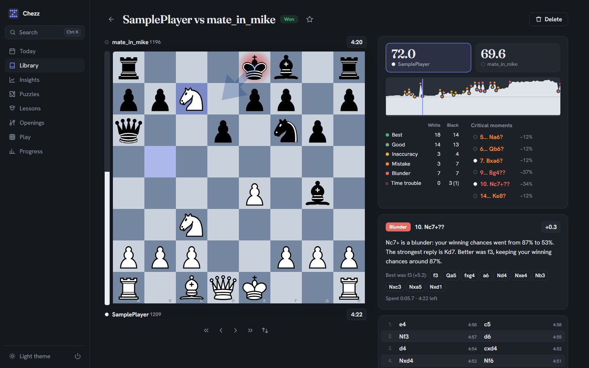
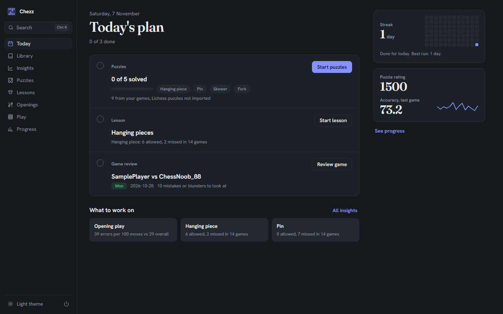
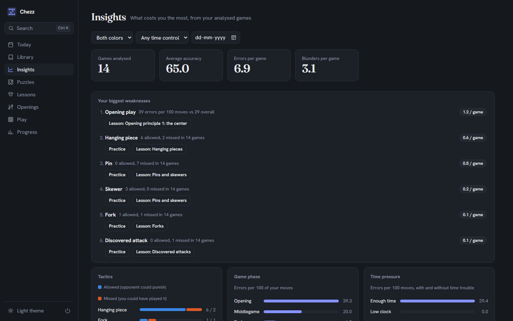

<p align="center">
  
</p>

<h1 align="center">Chezz</h1>

<p align="center">
  <b>Free, offline chess coaching built from your own games.</b><br>
  Engine game review, a weakness profile, puzzles from your own mistakes, lessons, opening drills
  and practice against Stockfish. Runs on your computer, needs no account, sends nothing anywhere.
</p>

<p align="center">
  
</p>

---

## Contents

- [What Chezz does](#what-chezz-does)
- [Requirements](#requirements)
- [Installation](#installation): [Windows](#windows) · [Linux](#linux) · [macOS](#macos)
- [First-time setup](#first-time-setup)
- [Getting your games](#getting-your-games)
- [Optional: the Lichess puzzle database](#optional-the-lichess-puzzle-database)
- [How to use Chezz](#how-to-use-chezz)
- [Keyboard shortcuts](#keyboard-shortcuts)
- [Configuration reference](#configuration-reference)
- [Your data, backups and updates](#your-data-backups-and-updates)
- [Troubleshooting](#troubleshooting)
- [For developers](#for-developers)
- [Resources and credits](#resources-and-credits)
- [License](#license)

---

## What Chezz does

| | |
|---|---|
| **Today's plan** | Every day: 5 puzzles, 1 lesson and 1 game to review, chosen from your weakest areas. Streak and rating trend at a glance. |
| **Library** | Import PGN files from chess.com, lichess or anywhere else. Duplicates are skipped. Filter by date, colour, result, opening, time control and your own tags; star games and write notes. |
| **Game review** | Stockfish checks every move and labels it *Best*, *Good*, *Inaccuracy*, *Mistake* or *Blunder*. You get an accuracy score per side, an eval graph with clickable critical moments, the engine's best line, plain-English explanations, and warnings when you were low on the clock. |
| **Insights** | Your weakness profile across all games: which game phase, which tactic (hanging pieces, forks, pins, skewers, back-rank, discovered attacks, missed mates), which openings and how time pressure costs you. |
| **Puzzles** | Puzzles made from your own blunders, plus (optionally) millions of rated puzzles from the free Lichess database. Hints, retries, solution playback, a personal puzzle rating, and failed puzzles come back on a spaced-repetition schedule. |
| **Lessons** | 32 short lessons on core tactics, basic mates, opening principles, key endgames and popular openings. Each has an explanation, interactive examples and a 10-puzzle drill. Lessons that match your weaknesses are recommended. |
| **Openings** | Builds a repertoire from the openings you actually play, drills it with spaced repetition, and shows the exact move where you left your repertoire or opening theory in past games. |
| **Play** | Play full games against Stockfish from about 600 to 3000 Elo. Finished games go straight into the library and are queued for review. Practise standard endgames (king and pawn, Lucena, Philidor, basic mates). |
| **Progress** | Accuracy, blunders per game, puzzle rating and how your weaknesses change over time. |

**Private by design:** no account, no telemetry, no internet connection needed while running.
Everything is stored in a single SQLite file on your machine.

<p align="center">
  
  
</p>

---

## Requirements

| What | Version | Why |
|---|---|---|
| **Python** | 3.11 or newer (3.12 recommended) | Runs the app |
| **Node.js** | 18 or newer | Builds the interface once, on first start. Not needed when using a [release zip](#option-b-release-zip-no-nodejs-needed) |
| **Stockfish** | any recent version (16+) | The chess engine behind reviews, puzzles and play |
| **Git** | any | To download the code (optional, you can also download a ZIP) |

Disk: a few hundred MB for dependencies, plus a few hundred more if you import the Lichess puzzle database.
The app itself is light; analysis uses as many CPU threads as you allow in the config.

Every package Chezz uses, with versions and licenses, is listed in [DEPENDENCIES.md](DEPENDENCIES.md).

---

## Installation

Chezz runs in its own desktop window. If a native window can't be opened, it opens in your
default web browser instead. Either way it is only reachable from your own computer.

### Windows

1. **Install Python.** Download it from [python.org/downloads](https://www.python.org/downloads/).
   In the installer, tick **"Add python.exe to PATH"**. The default options include the `py` launcher, which Chezz uses.
2. **Install Node.js.** Download the LTS version from [nodejs.org](https://nodejs.org/).
3. **Install Stockfish.** Open *PowerShell* and run:
   ```powershell
   winget install Stockfish.Stockfish
   ```
   Chezz finds the winget install automatically. Alternatively, download Stockfish from
   [stockfishchess.org/download](https://stockfishchess.org/download/) and unzip it into a folder
   named `engine` inside the Chezz folder.
4. **Get Chezz:**
   ```powershell
   git clone https://github.com/urmiljp/Chezz.git
   cd Chezz
   ```
   Without Git: click **Code → Download ZIP** on GitHub and extract it.
5. **Start it:** double-click `run.bat`, or run `.\run.bat` in a terminal.

The first start takes a few minutes. It creates a private Python environment in `.venv`,
installs dependencies and builds the interface. Later starts take a couple of seconds and work offline.

> Windows 10/11 already include the Microsoft Edge WebView2 runtime that the desktop window uses.
> If the window doesn't appear, install WebView2 from Microsoft, or run `run.bat --browser`.

### Linux

**1. Install system packages.** These include the GTK bindings for the native window.

Debian 12+ / Ubuntu 24.04+ / Linux Mint 22+:
```bash
sudo apt install git python3 python3-venv python3-gi gir1.2-webkit2-4.1 stockfish nodejs npm
```

Fedora:
```bash
sudo dnf install git python3 python3-gobject webkit2gtk4.1 stockfish nodejs npm
```

Arch / Manjaro:
```bash
sudo pacman -S git python python-gobject webkit2gtk-4.1 stockfish nodejs npm
```

**2. Get Chezz and start it:**
```bash
git clone https://github.com/urmiljp/Chezz.git
cd Chezz
./run.sh
```

The first start creates `.venv`, installs dependencies and builds the interface (a few minutes).
After that, `./run.sh` starts in seconds and works offline.

Notes for Linux:
- Debian and Ubuntu install Stockfish to `/usr/games/stockfish`. Chezz finds it there automatically.
- The native window uses your distribution's GTK and WebKit (`python3-gi`, `gir1.2-webkit2-4.1`).
  Without them, Chezz still works and simply opens in your browser.
- Older releases such as **Ubuntu 22.04** ship Python 3.10 and Node 12, which are too old.
  Install Python 3.11+ (for example from the *deadsnakes* PPA, with `python3.11-venv`) and Node 18+
  (from [nodejs.org](https://nodejs.org/) or `nvm`). The distribution's GTK bindings only work with
  its own Python, so on 22.04 Chezz will open in the browser.
- Want a menu entry? Create `~/.local/share/applications/chezz.desktop`:
  ```ini
  [Desktop Entry]
  Type=Application
  Name=Chezz
  Exec=/path/to/chezz/run.sh
  Icon=/path/to/chezz/assets/icon.png
  Terminal=false
  Categories=Game;BoardGame;Education;
  ```

### macOS

Not tested yet, but it should work the same way as Linux:
```bash
brew install python node stockfish git
git clone https://github.com/urmiljp/Chezz.git && cd Chezz && ./run.sh
```

### Option B: release zip (no Node.js needed)

If the project's **Releases** page has a `chezz-<version>.zip`, download it and extract it. It
includes the built interface, so you only need Python and Stockfish. Then run `run.bat` (Windows) or `./run.sh` (Linux/macOS).

---

## First-time setup

On first start, Chezz creates **`config.toml`** next to `run.bat` / `run.sh` (copied from
`config.example.toml`). Open it in any text editor and set **your username**:

```toml
username = "your_chesscom_name"
# Different names on chess.com and lichess? Use a list:
# username = ["your_chesscom_name", "your_lichess_name"]
```

Chezz uses this to know which side you played in each game. Without it, games still import, but
reviews, insights and the daily plan can't tell your moves from your opponent's. Restart Chezz
after editing the config.

If the Library page says *Stockfish not found*, set the engine path:

```toml
[engine]
path = "C:/tools/stockfish/stockfish-windows-x86-64-avx2.exe"   # Windows: use forward slashes
# path = "/usr/games/stockfish"                                  # Linux
```

All other options are explained in the [configuration reference](#configuration-reference).

---

## Getting your games

Chezz imports standard **PGN** files, and one file can hold many games. Clock times (`%clk`) are
kept, so Chezz can flag moves played in time trouble.

**chess.com**
1. Open [chess.com/games/archive](https://www.chess.com/games/archive) (Profile → Games → Archive).
2. Tick the games you want (the checkbox in the header selects the whole page).
3. Click **Download** to get a `.pgn` file.

**lichess**
- Open this address in your browser, with your username filled in. It downloads all your games, including clock times:
  ```
  https://lichess.org/api/games/user/YOUR_USERNAME?clocks=true
  ```
- To limit it to recent games, add `&max=200`.

**Import into Chezz:** **Library → Import PGN**, then pick the file or paste the PGN text. Then
click **Analyze all** to queue every new game for Stockfish. Analysis runs in the background, and
you can keep using the app while it works.

> Just want to look around first? On the empty Library page, click **Try sample games**.

---

## Optional: the Lichess puzzle database

Out of the box, puzzles come from **your own blunders**. For a much larger, rated set, add the
free Lichess puzzle database (millions of puzzles, CC0 public domain):

1. Download **`lichess_db_puzzle.csv.zst`** from [database.lichess.org](https://database.lichess.org/#puzzles).
2. Put it in your **Downloads** folder or Chezz's `data/` folder.
3. Open **Puzzles** in Chezz. If the file was found, click **Import**. Otherwise click
   **Choose file…** (or paste the path) and then **Import**. The import runs in the background and takes a few minutes.

Chezz keeps only well-rated, often-played puzzles, indexed by rating and theme, in
`data/lichess_puzzles.db`. You can delete the downloaded `.zst` file afterwards.

---

## How to use Chezz

A good daily routine: open **Today**, do the five puzzles, the lesson and the game review. That
takes 15–30 minutes, and everything in it is chosen from your own mistakes.

### Today
Your plan for the day, plus your streak, puzzle rating trend and the weakness to focus on. It is
regenerated each day from your latest weakness profile.

### Library
- **Import PGN** (or press `I`), **Analyze all**, and search (`/`) by player, opening, event or notes.
- Filter by date, colour, result, opening, time control, tag, or starred games.
- Open a game to star it (`S`), add tags and notes, or delete it.
- **Back up** saves a copy of the database. **Export PGN** writes every game to one file (see [your data](#your-data-backups-and-updates)).

### Game review
- Step through moves with the arrow keys and click the eval graph to jump to any moment.
- Each of your moves is labelled by how much it changed your winning chances:

  | Label | Winning chances lost |
  |---|---|
  | Best | the engine's move, or within 1% of it |
  | Good | less than 5% |
  | Inaccuracy | 5 to 10% |
  | Mistake | 10 to 15% |
  | Blunder | 15% or more |

- **Accuracy** (0 to 100) is computed per side from those win-chance changes, similar to the scores on popular chess sites.
- **Critical moments** are marked on the graph. A clock icon means the move was played under time pressure.
- **Re-run analysis** any time, for example after raising `depth` in the config. Chezz always shows the latest run.

**AI explanations (optional):** the built-in explanations are generated from engine data. For
richer coaching, go to the **Explanations** card and export **Key moments** or the **Whole game**
to get a ready-made prompt. Paste it into any AI chat assistant, copy its whole reply, and use
**Import reply** to bring the explanations back into the review. No API key is needed, and you choose what to share.

### Insights
Your weakness profile across all analysed games, or a filtered subset. It shows errors by game phase,
tactic type, opening and time pressure, each with a direct link to practise it. This profile drives
the daily plan and the lesson recommendations.

### Puzzles
- Modes: **Mixed**, **Today's plan** (your weak themes), **My mistakes** (puzzles from your own games), **Review** (failed puzzles that are due again). You can also filter by a single theme.
- Make moves on the board. `H` gives a hint, `Z` takes back a move, `N` goes to the next puzzle.
- Your **puzzle rating** goes up and down with each attempt (Glicko-style). Failed puzzles return on a spaced-repetition schedule until you solve them reliably.
- Puzzles made from your own games link back to the moment in the game where you went wrong.

### Lessons
32 short lessons, each with one screen of explanation, interactive examples, then a 10-puzzle drill on the same theme:
- **Tactics:** hanging pieces, forks, pins and skewers, discovered attacks
- **Checkmates:** back-rank and basic mates
- **Opening principles:** the center, development, king safety
- **Endgames:** opposition, the rule of the square, Lucena, Philidor
- **Openings:** 8 for White and 12 for Black (Italian, Ruy Lopez, London, Sicilian, French, Caro-Kann and more). Each can add its main line to your repertoire.

### Openings
- **Build my repertoire** creates a repertoire from your own games (for White and for Black). Edit it move by move on the **Repertoire** tab.
- **Drill** asks you to play your repertoire move in each position, with spaced repetition.
- **Where you left book** lists recent games and the first move where you (or your opponent) left opening theory or your repertoire.

### Play
- **Full game:** choose your colour and the engine's strength (about 600 to 3000 Elo). The finished game is saved to the library and queued for review.
- **Endgames:** practise standard positions such as king and pawn, Lucena, Philidor, and mating with queen or rook against a full-strength engine.

### Progress
Charts of accuracy, blunders per game, puzzle rating, and how much each weakness contributes over time.

---

## Keyboard shortcuts

Press `?` anywhere in the app to see this list.

| Key | Action |
|---|---|
| `Ctrl` + `K` | Search pages, games and lessons |
| `1` – `8` | Jump to a section (Today, Library, Insights, Puzzles, Lessons, Openings, Play, Progress) |
| `←` `→` | Step through moves |
| `↑` `↓` | First / last move |
| `F` | Flip the board |
| `S` | Star the game |
| `Z` | Undo a puzzle move |
| `H` | Puzzle hint |
| `N` | Next puzzle |
| `/` | Search the library |
| `I` | Import PGN (library) |

---

## Configuration reference

`config.toml` (created on first start from `config.example.toml`). Restart Chezz after changes.

| Setting | Default | Meaning |
|---|---|---|
| `username` | `""` | Your username, or a list of names. Decides which side is "you". |
| `[engine] path` | `""` | Stockfish binary. Empty = auto-detect (PATH, `./engine/`, `/usr/games`, winget). |
| `[engine] threads` | `2` | CPU threads for analysis. More = faster reviews. |
| `[engine] hash` | `256` | Engine memory in MB. |
| `[engine] depth` | `16` | Search depth per move. 14 is quick; 18–20 is stronger and slower. |
| `[engine] movetime_ms` | `0` | If above 0, think a fixed time per move instead of using `depth`. |
| `[app] port` | `8765` | Local port for the app. Change it if another program uses 8765. |
| `[app] data_dir` | `"data"` | Where your database lives (relative to the config file, or an absolute path). |

Command-line options (they work with `run.bat` and `run.sh` too):

```
--browser       open in your web browser instead of a desktop window
--server-only   start without opening any window (then visit http://127.0.0.1:8765)
--port N        use another port for this run
```

To keep the config somewhere else, set the environment variable `CHEZZ_CONFIG=/path/to/config.toml`.

---

## Your data, backups and updates

Everything lives in the `data/` folder:

| Path | Contents |
|---|---|
| `data/chezz.db` | Your games, analyses, puzzles, progress, repertoire (SQLite) |
| `data/lichess_puzzles.db` | Imported Lichess puzzles (optional) |
| `data/backups/` | Copies made by **Library → Back up** |
| `data/exports/` | PGN exports and AI-explanation batches |
| `data/webview/` | Window settings (theme, play preferences) |

- **Back up:** **Library → Back up** makes a consistent copy even while Chezz is running.
  Or close Chezz and copy the whole `data/` folder.
- **Move to another computer:** copy `data/` and `config.toml` into the new Chezz folder.
- **Update Chezz:** `git pull`, then start it as usual. Dependencies and the interface rebuild automatically when needed. Your `data/` and `config.toml` are never touched by updates.
- **Start over:** close Chezz and delete `data/chezz.db` (keep `lichess_puzzles.db` to avoid re-importing).

---

## Troubleshooting

| Problem | Fix |
|---|---|
| *Stockfish not found* | Install Stockfish (see [Installation](#installation)) or set `[engine] path` in `config.toml`, then restart. |
| *Could not start the server on port 8765* | Chezz is already running, or another program uses the port. Close the other copy or start with `--port 8790`. |
| No desktop window opens (Linux) | Install `python3-gi` and `gir1.2-webkit2-4.1` (or your distro's equivalents), delete `.venv`, and run `./run.sh` again. Or use `./run.sh --browser`. |
| *Frontend is not built and npm was not found* | Install Node.js 18+, or use a release zip. |
| `python3 -m venv` fails (Debian/Ubuntu) | `sudo apt install python3-venv`, then run again. |
| Games import but nothing shows in Insights | Set `username` in `config.toml` to the name in your PGN files, restart, and analyse the games. |
| *Forbidden: Chezz only accepts requests from its own window* | Open Chezz at `http://127.0.0.1:<port>` or `http://localhost:<port>`. Other addresses are blocked on purpose (see [Security](#security)). |
| Something else is broken | Run from a terminal to see the error output, and open an issue with it. |

---

## For developers

**Stack:** Python (FastAPI, uvicorn, SQLite in WAL mode, python-chess) with Stockfish over UCI. The
interface is TypeScript, built with Vite: chessground for the board, chess.js for move logic, uPlot for charts. pywebview provides the desktop window.

```bash
# one-time: add the test tools (pytest, httpx) to the app's environment
.venv/bin/python -m pip install -e ".[dev]"   # Windows: .venv\Scripts\python -m pip ...

# run the tests (engine tests are skipped when Stockfish isn't installed)
.venv/bin/python -m pytest              # Windows: .venv\Scripts\python -m pytest

# live-reloading UI: start the API, then the Vite dev server
.venv/bin/python -m chezz --server-only
cd web && npm run dev                   # open the URL Vite prints

# build a release zip (includes the built UI) into dist/
.venv/bin/python scripts/package.py
```

**Project layout**

```
chezz/            Python backend
  api*.py           HTTP routes            analysis.py   background engine worker
  review.py         classification math    tactics.py    tactic tagging heuristics
  weakness.py       weakness profile       puzzles.py    puzzles, rating, spaced repetition
  openings.py       repertoire + drills    lessons.py    lesson loading and progress
  play.py           play vs engine         ingest.py     PGN import and dedupe
web/src/          TypeScript interface (one file per page)
content/          lessons (JSON), endgame positions, ECO opening table
samples/          sample games used by tests and "Try sample games"
tests/            pytest suite
assets/           logo and app icons
```

**Writing a lesson:** add a JSON file to `content/lessons/`. Copy an existing one as a template.
It is picked up on the next start.

### Security
Chezz runs a small web server that listens only on `127.0.0.1`. It only answers requests whose
`Host` is `127.0.0.1` or `localhost`, and only from its own page. That stops other websites open in
your browser from calling it (cross-site requests and DNS rebinding). To report a security issue,
please open a private security advisory on GitHub rather than a public issue.

---

## Resources and credits

Chezz stands on the shoulders of these free projects (full list in [DEPENDENCIES.md](DEPENDENCIES.md)):

- [Stockfish](https://stockfishchess.org/): the chess engine (GPL-3.0, installed separately)
- [python-chess](https://github.com/niklasf/python-chess): move generation, PGN and UCI (GPL-3.0)
- [chessground](https://github.com/lichess-org/chessground): the board UI from lichess (GPL-3.0)
- [chess.js](https://github.com/jhlywa/chess.js): move validation in the interface (BSD-2)
- [uPlot](https://github.com/leeoniya/uPlot): charts (MIT)
- [Lichess puzzle database](https://database.lichess.org/#puzzles) and
  [lichess chess-openings](https://github.com/lichess-org/chess-openings): puzzles and the ECO opening table (CC0)
- [FastAPI](https://fastapi.tiangolo.com/), [uvicorn](https://www.uvicorn.org/), [pywebview](https://pywebview.flowrl.com/), [Vite](https://vitejs.dev/)
- Fonts: [Hanken Grotesk](https://fonts.google.com/specimen/Hanken+Grotesk) and [Fraunces](https://fonts.google.com/specimen/Fraunces) (OFL)
- Piece set: *cburnett*, as bundled with chessground

Learning more:
- [Lichess practice](https://lichess.org/practice) and [Lichess study](https://lichess.org/study) for free interactive lessons
- [Lichess opening explorer](https://lichess.org/analysis#explorer) to check opening theory
- [Chessprogramming wiki](https://www.chessprogramming.org/) on how engines like Stockfish work

---

## License

Chezz is free software, released under the **GNU General Public License v3.0 or later**. See
[LICENSE](LICENSE). This follows from its use of python-chess and chessground, both GPL-3.0. You may
use, study, share and modify it. If you distribute a modified version, it must stay under the same license.
